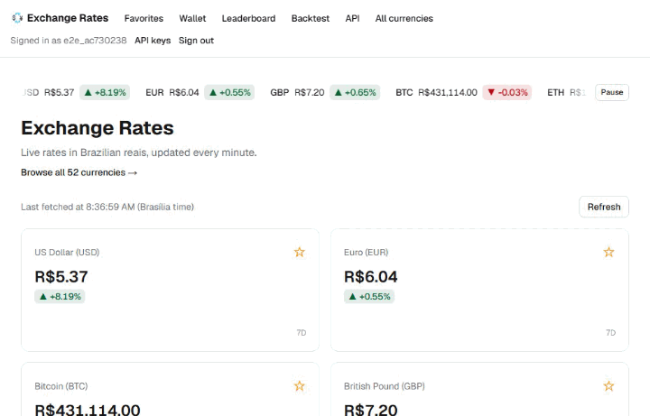
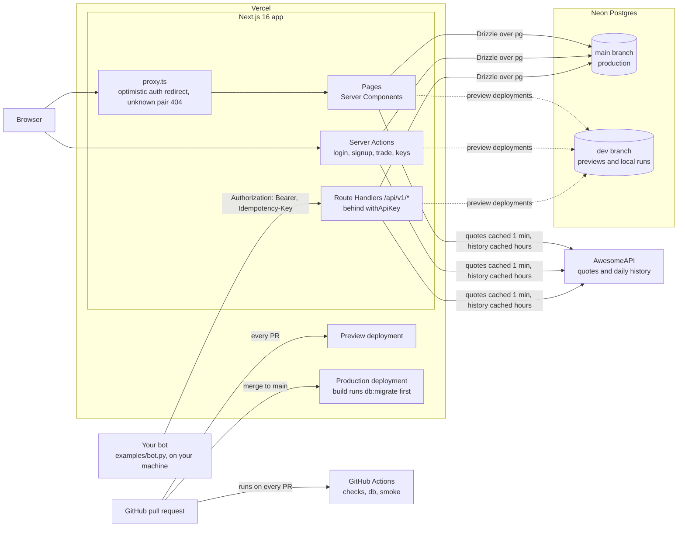
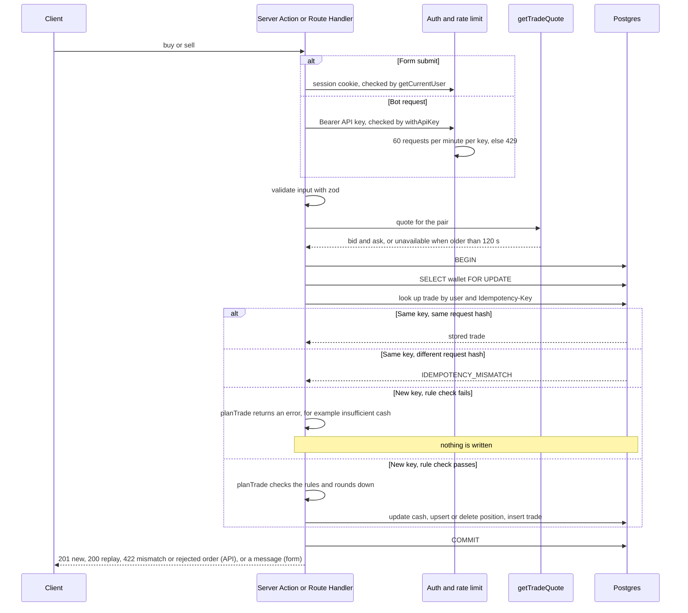

# Paper Trading Simulator

A paper-trading app built with Next.js 16 and Postgres. Every account starts with R$ 100,000 of virtual cash and trades currency and crypto pairs at live quotes from AwesomeAPI. Buys fill at the ask, sells at the bid, and all rounding favors the house. Users can also backtest strategies against the last year of prices, see how they rank on a public leaderboard, and trade through an HTTP API, so a bot or model running on their own machine can trade the same wallet as the web app.

## Live demo

**https://next-js-training-ten-gamma.vercel.app**

On the login page, click **Try the demo** to enter a shared demo account with one click. Anyone can reset that wallet, so the demo account is left off the leaderboard and cannot create API keys. To get your own wallet and API key, create an account at `/signup`.



## Features

### Accounts and wallet

- Sign up with a username and password. Five wrong passwords lock the account for 15 minutes.
- Buy with an amount in BRL (minimum R$ 1.00) or sell a quantity, or sell everything. Orders fill at the current quote, and are rejected if that quote is more than 2 minutes old.
- `/wallet` shows total value, return since the wallet started, positions with average cost and profit/loss, a daily value chart rebuilt from the trade history, and the trade history. Reset returns the wallet to R$ 100,000 after a confirmation step.
- `/currency/[pair]` shows the price chart and the buy/sell form. Logged-out visitors see "Sign in to trade".
- `/leaderboard` is public and shows the top 10 accounts by return, usernames only.

### Backtester

- `/backtest` is public and never touches a wallet. It simulates the last year of daily closes, starting with R$ 100,000.
- Three strategies: buy and hold (always shown as the benchmark), buy the dip (buy after a drop, sell at a take-profit), and a moving-average crossover.
- Results show final value, return, number of trades, max drawdown, and an equity curve against buy and hold. The settings live in the URL, so a result is a shareable link.

### Bot API

- Create up to 3 API keys at `/settings/api-keys`. A key is shown once.
- `GET /api/v1/quotes`, `GET /api/v1/history/{pair}`, `GET /api/v1/wallet`, and `GET` and `POST /api/v1/orders`. Every endpoint requires `Authorization: Bearer <key>`.
- Orders go through the same trade function as the web form. `POST /api/v1/orders` requires an `Idempotency-Key` header, so a retry never trades twice.
- 60 requests per minute per key. Over the limit, the API returns `429` with `Retry-After`.
- Errors share one JSON shape. The reference, with curl examples, is at `/docs/api`.
- A house bot account trades USD, EUR, GBP and BTC once a day through this same API, and shows on the leaderboard with a "bot" tag.

## Architecture

The browser and a bot on your machine both reach the same Next.js app. It reads prices from AwesomeAPI and keeps wallets in Postgres. GitHub and Vercel handle delivery.



Every order takes the same path, whether it comes from the form or from the API:



For a five-minute walkthrough of the live app, see [docs/DEMO.md](docs/DEMO.md).

## How it works

Next.js 16 (App Router, Cache Components, Server Actions, Route Handlers), React 19, TypeScript, Tailwind CSS 4, Postgres on Neon with Drizzle ORM over `pg`, zod for input validation, Vitest for tests, deployed on Vercel. The design doc and the implementation plan are in `docs/superpowers/`.

- **Money.** BRL is stored as integer cents. Quantities and prices are 10-decimal fixed-point `bigint`s, stored as `numeric(30, 10)`. Balances and trades never use floats, and every rounding goes down. The backtester simulates with floats but stores nothing. Buys fill at the ask, sells at the bid. See `lib/money.ts` and `lib/db/schema.ts`.
- **Row lock and idempotency.** Each trade runs in one transaction. It locks the wallet row with `SELECT ... FOR UPDATE`, checks for an existing trade with the same idempotency key, re-checks the rules, then writes cash, position and trade together. Two simultaneous buys cannot spend the same cash, and a repeated key returns the original trade. A unique index on (user, idempotency key) backs this. Reusing a key for a different order returns `422`. See `lib/trading.ts` (`executeTrade`) and `drizzle/0000_great_blue_marvel.sql`.
- **Quote freshness.** A trade needs a quote that the server fetched within the last 2 minutes. A quote with a missing, zero or non-numeric bid or ask is untradable. See `lib/trade-quote.ts` and `lib/quotes.ts`.
- **Rate limits.** A fixed one-minute window counted in a Postgres table. It covers API requests (60 per key per minute, in `withApiKey`) and sign-ups (5 per IP per hour). See `lib/rate-limit.ts`, `lib/api.ts` and `app/auth-actions.ts`.
- **Auth.** Passwords are hashed with `scrypt` and compared with `timingSafeEqual`. An unknown username costs the same scrypt run as a wrong password, so timing does not reveal which usernames exist. The session cookie is an HMAC-SHA256 signed token, set `HttpOnly` with `SameSite=Lax`. See `lib/password.ts`, `lib/session-token.ts`, `lib/session.ts`, and the lockout in `lib/users.ts`.
- **Motion without a library.**
  - Page slides and the wallet's skeleton-to-content handoff use React's `<ViewTransition>`.
  - The ticker, row stagger, chart draw-in and scroll reveal are plain CSS.
  - Only small client islands hold state: the pause button, the chart crosshair, the copy buttons and the price roll (NumberFlow). Pages and cards stay Server Components.
  - Everything respects `prefers-reduced-motion`, and the ticker has a visible pause button (WCAG 2.2.2).
  - The whole polish round added at most 6.5 KB gzip of client JS to a route. Lighthouse scores before and after are in [docs/perf-baseline.md](docs/perf-baseline.md).
- **API keys.** A key is `ptk_` plus 32 random bytes. The database stores only its SHA-256 hash and a short prefix for display. The demo account cannot create keys. See `lib/api-keys.ts`.

## API quick start

Sign up for your own account (the demo account cannot create keys), then create a key at `/settings/api-keys`. Keys look like `ptk_...`.

```bash
export API_KEY=ptk_your_key
BASE=https://next-js-training-ten-gamma.vercel.app

# Cash, positions and total value
curl -H "Authorization: Bearer $API_KEY" "$BASE/api/v1/wallet"

# Buy R$ 100.00 of USD-BRL. Repeating this exact request with the same Idempotency-Key returns the original trade.
curl -X POST "$BASE/api/v1/orders" \
  -H "Authorization: Bearer $API_KEY" \
  -H "Idempotency-Key: 3f9c1e7a-5b2d-4e8f-9a61-0c4d7b2e8f15" \
  -H "Content-Type: application/json" \
  -d '{"pair":"USD-BRL","side":"buy","brl":"100.00"}'
```

[`examples/bot.py`](examples/bot.py) is a complete bot that uses only the Python standard library. It compares the 5-day and 20-day averages of daily closes. It buys R$ 1,000.00 when the short average is above the long one and no position is held, and sells the whole position when the short average falls below it. It places orders on your paper wallet:

```bash
API_KEY=ptk_your_key python examples/bot.py
```

Set `PAIR` or `BASE_URL` to change the pair or the host. The bot runs on your machine; the server never runs your code. For the full reference (every endpoint, error codes, limits and idempotency rules), see `/docs/api`.

## Run it locally

You need Node 24 (the version CI uses) and a Postgres database. Use a **development** database, such as the Neon `dev` branch. Never point a local run at production.

```bash
npm ci
cp .env.example .env.local      # on Windows: copy .env.example .env.local
```

Fill in `.env.local`. The file is git-ignored, and `.env.example` explains each variable:

- `SESSION_SECRET`: at least 32 random characters.
- `DATABASE_URL`: the pooled connection string for your dev database. The app uses it at runtime.
- `DATABASE_URL_UNPOOLED`: the direct connection string for the same dev database. Migrations use it.
- `AWESOMEAPI_KEY`: optional. It raises the quote API's rate limit.
- `CRON_SECRET` and `HOUSE_BOT_API_KEY`: set these for the Production environment only, not Preview. They let Vercel Cron run the house bot, so leave them empty locally.

```bash
npm run db:migrate   # applies the SQL in drizzle/
npm run dev          # http://localhost:3000
```

## Tests

- `npm test`: unit tests for the pure logic (trade math, valuation, the three backtest strategies, rate-limit windows, API key format, password hashing, portfolio history). No database needed.
- `npm run test:db`: database tests, run against the database in `.env.local`. They write rows, so use a dev database. They cover two simultaneous buys that compete for the same cash, idempotent order replay, the 3-key limit, login lockout and rate limiting.
- `npm run smoke`: starts `next dev` on port 3100 against the database and a fake AwesomeAPI on port 3999. It seeds a test user, requests the main pages with and without a session, and fails on any server error. It reads `DATABASE_URL` and `SESSION_SECRET` from the shell, not from `.env.local`, so export both first. It also writes a test user, so use a dev database.
- `npm run e2e`: a Playwright test that clicks through the real UI: sign up, buy USD-BRL, sell all, check the two trades in the wallet, then reset. Without `E2E_BASE_URL` it starts the fake AwesomeAPI and its own `next dev` on port 3100 (stop any other dev server in the folder first). With `E2E_BASE_URL=http://localhost:3000` it uses a dev server you already run, with the real quote API and your dev database. It creates a throwaway user each run, and sign-ups are limited to 5 per IP per hour, so repeated local runs against the same database can hit "Too many sign-ups" (CI starts from an empty database each time).
- `npm run lint` and `npm run typecheck`: ESLint, then `next typegen` and `tsc --noEmit`.

## CI/CD

GitHub Actions (`.github/workflows/ci.yml`) runs on every pull request and on every push to `main`:

- `checks`: `npm ci`, lint, typecheck, unit tests, and `next build`. The build runs without secrets or a database.
- `db`: a Postgres 17 service container, migrations, then `npm run test:db`.
- `smoke`: a Postgres 17 service container, migrations, then `npm run smoke`.
- `e2e`: the same Postgres and environment as `smoke`, migrations, Chromium, then `npm run e2e`. On failure it uploads the Playwright report and traces as an artifact.

Vercel deploys each pull request as a preview that uses the Neon `dev` branch. Merging to `main` deploys production, which uses the Neon `main` branch. `vercel.json` sets the build command to `npm run db:migrate && npm run build`, so migrations run before the new code goes live.

Branch protection on `main` requires a pull request, passing `checks`, `db` and `smoke` jobs, and a squash merge.
